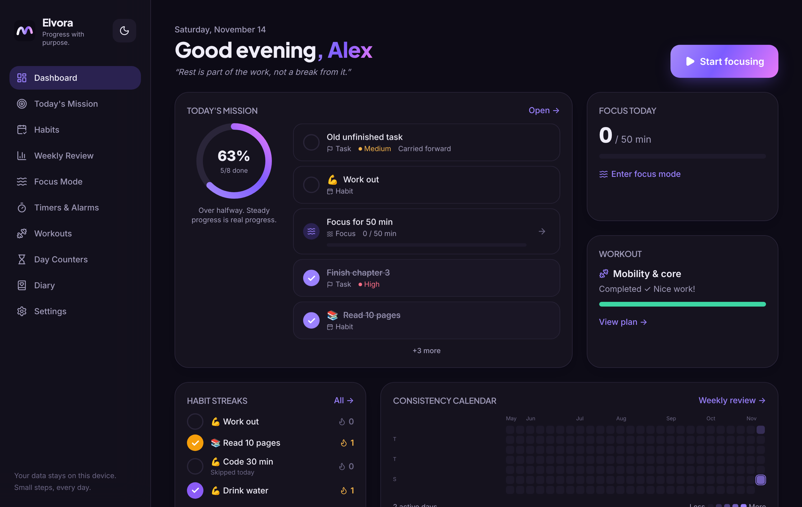
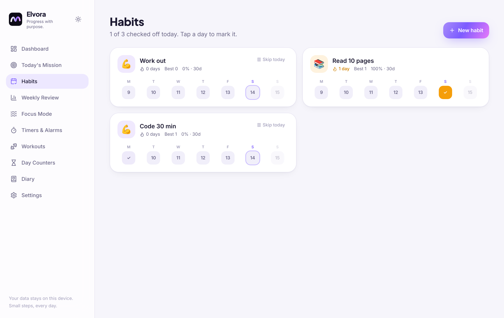
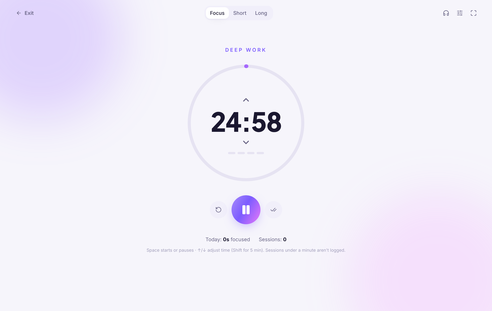
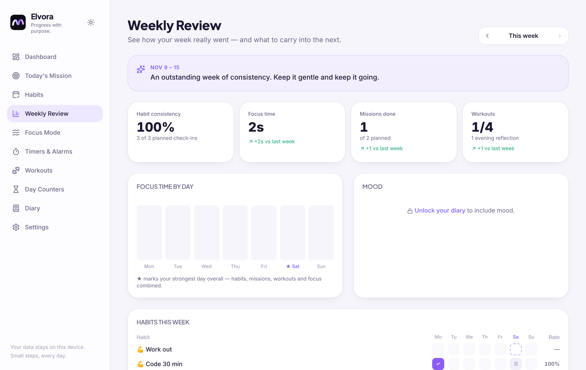
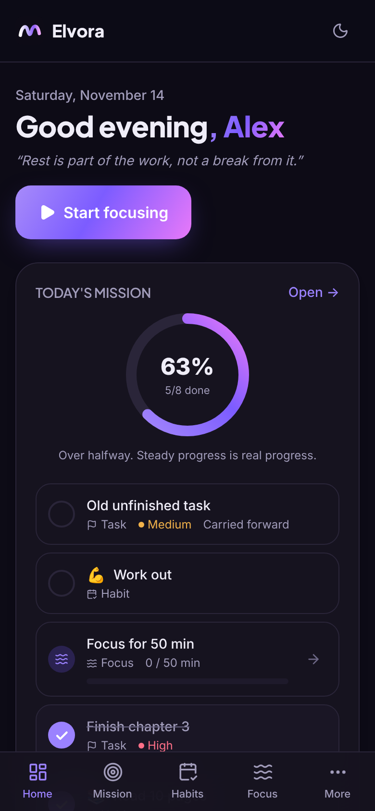

# Elvora — Progress with purpose.

[](https://github.com/immanuellangat/elvora/actions/workflows/deploy.yml)

A calm, offline-first companion for building consistency: habits, Today's Mission, focus sessions, workouts, day counters and a private diary with evening reflection.

**[▶ Open the live app](https://immanuellangat.github.io/elvora/)** — nothing to install, no account, and your data never leaves your device.



| Habits | Focus Mode |
| --- | --- |
|  |  |

| Weekly Review | On a phone |
| --- | --- |
|  |  |

## Run it

```bash
npm install
npm run dev        # development server at http://localhost:5173
npm run build      # type-check + production build (with service worker)
npm run preview    # serve the production build at http://localhost:4173
```

Install it like an app from the browser menu ("Install app" / "Add to Home Screen") or from **Settings → App → Install**.

## Features

| Area | What it does |
| --- | --- |
| **Dashboard** | Today's mission progress, focus time vs. goal, today's workout, habit streaks, a 26-week consistency calendar, day counters and milestones. |
| **Today's Mission** | Combines your tasks, planned habits, today's workout and the daily focus goal. Priorities (High/Medium/Low), move to tomorrow, plan future days, and a gentle "unfinished from earlier" review to carry tasks forward or let them go. |
| **Habits** | Any habit, on any weekdays. Tap days to check in (past days can be fixed). Streaks only count planned days, so rest days never break them. **Skip days** (sick, travel, rest) pause a streak instead of breaking it, and **"Never miss twice"** forgives a single missed day. Optional **daily reminders** give a gentle nudge on planned days, only if you haven't checked in yet. 30-day rate, best streak and badges. |
| **Weekly Review** | Your week compared with the last: habit consistency, focus time, missions and workouts, a habit-by-day grid, focus and mood charts, gentle insights (strongest day, most consistent habit, mood vs. focus) and wins gathered from your reflections. |
| **Focus Mode** | Full-screen Pomodoro timer with breaks, presets, auto-start options, and link to a mission or habit. Sound panel with offline ambient sounds (rain, ocean, wind, noise), online radio/YouTube, your own links, and your own music files stored for offline playback. |
| **Timers & Alarms** | Countdown (adjust with ▲/▼ or arrow keys) and stopwatch with laps, logged per activity with a 7-day breakdown. Alarms for any time of day, once or on chosen weekdays, with a label, 5 built-in offline sounds, gentle volume ramp, snooze and a full-screen ringing view. Countdowns can ring until stopped. Alarms ring while the app is open (a background tab or the installed app is fine). |
| **Workouts** | Beginner-friendly weekly plan with rest days, exercise tips and a library to customise each day. Track exercises and completed workouts. |
| **Day Counters** | "Day N" counters with optional goals, milestones, and a forgiving "start over" that keeps your best run. |
| **Diary** | Dated entries with mood, free writing and reflection prompts. Search, a mood trend, and autosave. |
| **Evening Reflection** | Shows a summary of the day, then three questions: what you accomplished, what challenges you faced, and what you want to achieve tomorrow. Turns tomorrow's goals into missions and can carry unfinished tasks into tomorrow. |

Timers keep running across pages, refreshes and restarts, and the tab title shows the time remaining. Optional notifications fire when a session ends in the background.

## Privacy & storage

- **Local only.** All data lives in the browser's IndexedDB on this device. No accounts, no servers, no analytics.
- **Diary passcode (optional).** Entries are encrypted with AES-256-GCM using a key derived from your passcode (PBKDF2-SHA-256, 310k iterations). The key is held only in memory: the diary locks on reload and after inactivity. **A forgotten passcode cannot be recovered.**
- **Backups.** Settings → Your data → Export/Import (JSON). Encrypted diary entries stay encrypted in the backup. Music files are not included in backups.
- Encryption needs a secure context (https or `localhost`).

## Offline

The service worker caches the whole app, so everything works offline after the first visit. Only online radio and YouTube need a connection; ambient sounds and your own music files work offline.

## Tech stack

React 19 · TypeScript · Vite · Tailwind CSS v4 · Framer Motion · Dexie (IndexedDB) · vite-plugin-pwa (Workbox) · date-fns · lucide-react.

```
src/
  db/          schema, types, actions (writes), queries (reads), settings, backup
  lib/         pure logic: streaks, missions, dates, crypto, audio, workouts, achievements
  state/       app-wide providers: timers, sound/music, diary lock, toasts
  components/  UI kit, layout, mission rows, calendars, sound panel
  pages/       one file per screen
  test/        unit tests (vitest + fake-indexeddb)
e2e/smoke.mjs  browser test of every feature (headless Microsoft Edge)
```

## Tests

```bash
npm test                              # unit tests
npm run build && npm run preview      # then, in another terminal:
npm run e2e                           # end-to-end test in headless Edge
```

The end-to-end test uses Microsoft Edge by default. To run it with another Chromium-based browser (for example on Linux), point `E2E_BROWSER_PATH` at the browser binary:

```bash
E2E_BROWSER_PATH=/usr/bin/chromium npm run e2e
```

The screenshots above come from that test: `E2E_SCALE=2 npm run e2e` saves high-resolution captures of every screen to `e2e/screenshots/`.
